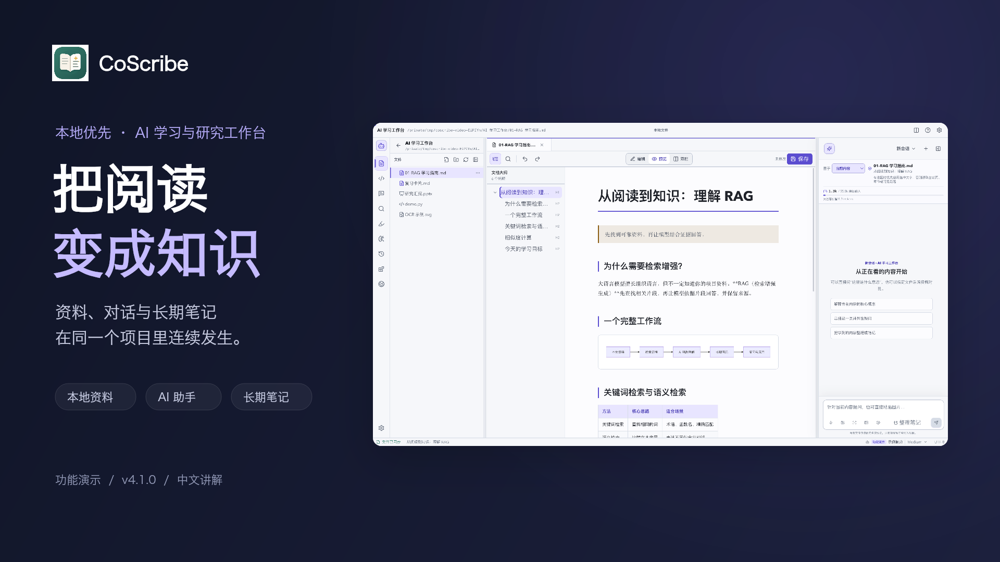

# CoScribe 功能演示

[观看／下载 MP4](https://github.com/UESTC-ly/CoScribe/raw/refs/heads/main/docs/videos/coscribe-demo-zh-CN.mp4) · [下载中文字幕](./coscribe-demo-zh-CN.srt)

视频基于 CoScribe `v4.1.0`，于 2026-10-26 在 macOS 上录制，时长约 2 分 52 秒，分辨率 1920 × 1080，30 fps，采用 H.264 视频和 AAC 音频。包含中文神经合成配音、内嵌中文字幕和播放器章节；独立 SRT 可用于重新编辑。

## 章节

| 时间 | 内容 |
| --- | --- |
| 00:00 | CoScribe：把阅读变成知识 |
| 00:14 | 打开资料，进入学习现场 |
| 00:32 | 把正确的上下文交给 AI |
| 00:52 | 从一次对话，沉淀一份笔记 |
| 01:09 | 多种资料，一处阅读 |
| 01:27 | 让助手记住你的表达偏好 |
| 01:44 | 把理解变成可追踪的复习 |
| 02:03 | 用插件组织研究与计划 |
| 02:21 | 学习与实践，在同一工作区 |
| 02:38 | 让知识留在自己的项目里 |

## 演示范围

录制使用独立示例项目和独立用户数据目录。AI 提问与笔记生成通过本机示例服务返回预设内容，视频画面和配音均已说明；这部分用于展示交互流程，不代表远程模型的实际效果或响应速度。

资料阅读、笔记预览与确认写入、本地 OCR、个人记忆保存、复习反馈、演示文献与日程保存，以及终端执行均为真实应用操作。演示文献是明确标注的虚构条目。视频经过剪辑和节奏调整，不用于性能测量。

资料浏览器、每日复盘、文献综述矩阵、MCP 和 Git 快照等其他能力在结尾列出，未逐一操作演示。完整使用说明见[项目 README](../../README.md)和[文档中心](../README.md)。

## 配音与验证

配音使用 Microsoft `zh-CN-XiaoxiaoNeural` 合成语音，以章节为单位连续生成，并根据返回的句子时间戳同步字幕。它是合成语音，不是真人录音。

录制前已完成 `npm run build`（含 TypeScript 检查），并核对演示中的保存、识别、复习和终端结果。最终视频通过全片解码检查，检查了关键帧、字幕及音频电平。

仓库只保存自然配音成片、封面与独立字幕。原始录屏、旧版配音、临时音频、示例项目及录制控制文件位于本地 `output/playwright/coscribe-demo/`，不纳入版本控制。
